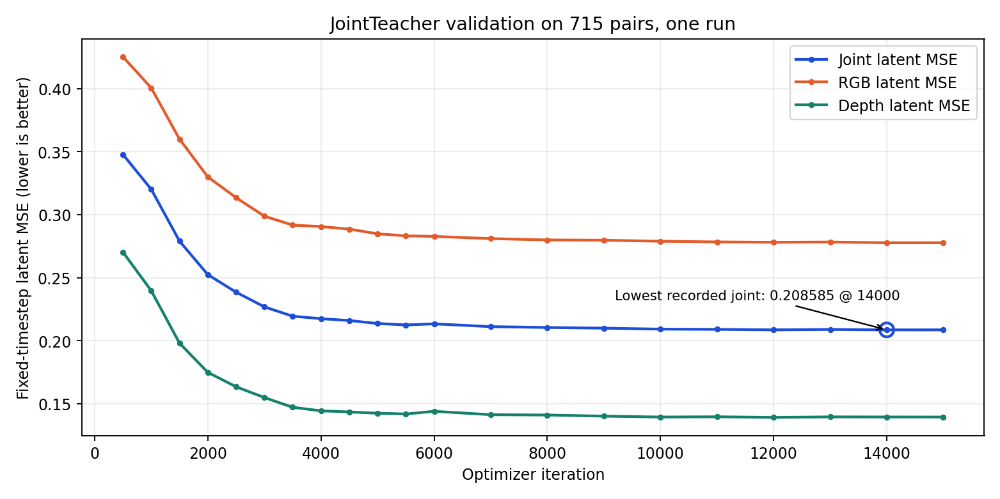
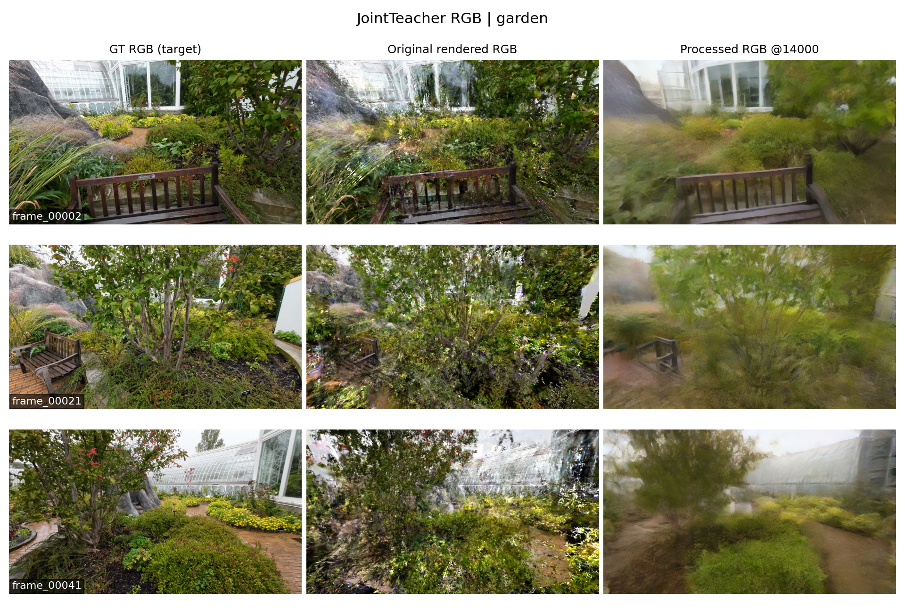
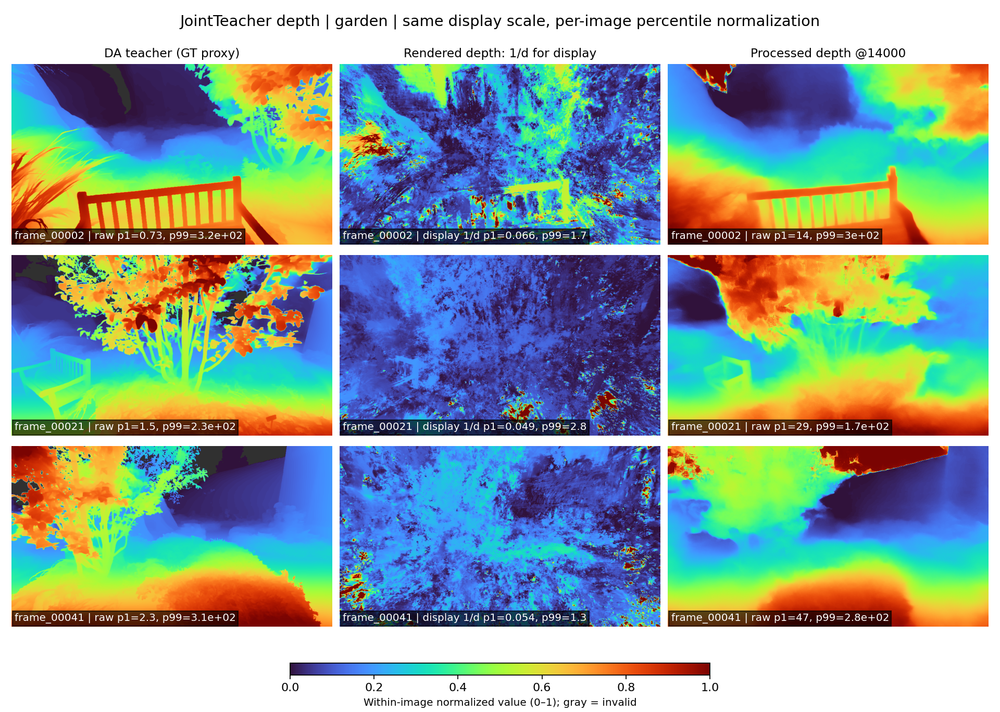
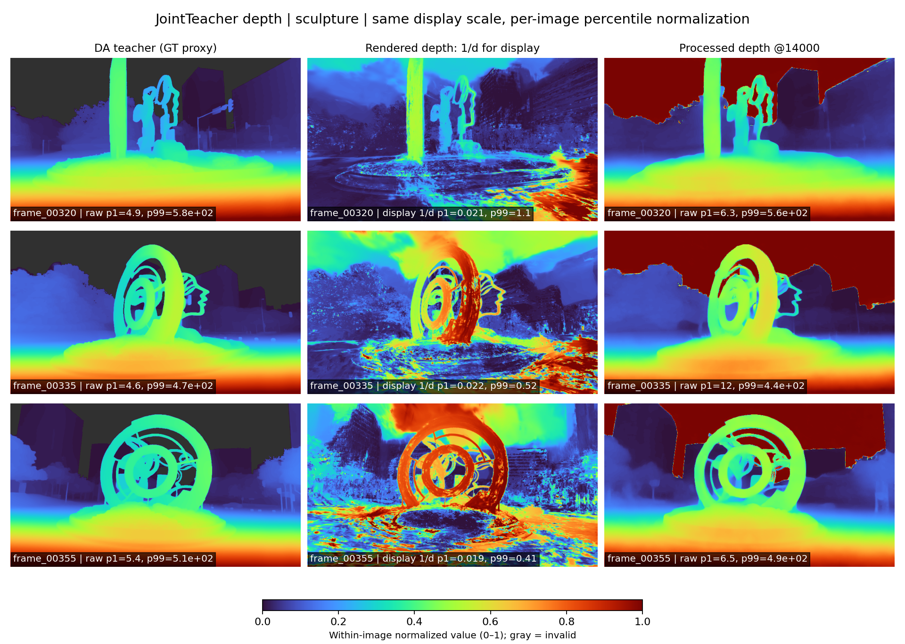
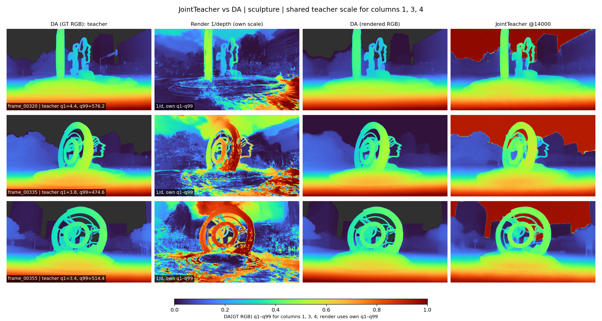

# JointTeacher 运行结果与原始图像

## 运行与指标口径

本文整理的运行是 `output/20261002_164657_train_rgbdepth_teacher_perimg`，从 2026-10-02 16:46:57 训练到 2026-10-03 09:12:22，日志记录 `Training ended.`，共 **15000** 次 optimizer iteration。训练集 36430 pair、验证集 715 pair；验证集只含两个场景，且包含 48 条 `*_ref` 输入。实际全局 batch 为 32。运行配置与字段解释见 [方法文档](method.md)。

下表来自运行目录每个 `eval-RGB+DepthCond_PerImg_Val-iter*.txt` 的原始文件。这是 **固定 \(t=500\) 的单步 latent velocity MSE**，并非完整采样图像的 MSE，也不是可直接与真实深度比较的米制误差。三个指标均越低越好。

| Iter | Joint latent MSE | RGB latent MSE | Depth latent MSE |
|---:|---:|---:|---:|
| 500 | 0.347668 | 0.425141 | 0.270195 |
| 1000 | 0.320033 | 0.400434 | 0.239633 |
| 1500 | 0.278908 | 0.359816 | 0.198000 |
| 2000 | 0.252385 | 0.329905 | 0.174865 |
| 2500 | 0.238442 | 0.313431 | 0.163453 |
| 3000 | 0.226822 | 0.298737 | 0.154908 |
| 3500 | 0.219411 | 0.291653 | 0.147169 |
| 4000 | 0.217461 | 0.290529 | 0.144392 |
| 4500 | 0.215990 | 0.288495 | 0.143485 |
| 5000 | 0.213621 | 0.284765 | 0.142476 |
| 5500 | 0.212511 | 0.283158 | 0.141864 |
| 6000 | 0.213345 | 0.282692 | 0.143998 |
| 7000 | 0.211143 | 0.280966 | 0.141321 |
| 8000 | 0.210467 | 0.279877 | 0.141056 |
| 9000 | 0.209924 | 0.279676 | 0.140171 |
| 10000 | 0.209166 | 0.278887 | 0.139445 |
| 11000 | 0.208984 | 0.278320 | 0.139648 |
| 12000 | 0.208589 | 0.278027 | **0.139151** |
| 13000 | 0.208910 | 0.278243 | 0.139577 |
| **14000** | **0.208585** | **0.277684** | 0.139486 |
| 15000 | 0.208589 | 0.277734 | 0.139443 |

表中的粗体分别表示本次记录中 joint、RGB、depth 的最低数值；depth 的最低点在 12000 步。完整精度见 [CSV](evidence/validation_metrics.csv)，逐次验证的原始文本保存在 [evidence/evaluation](evidence/evaluation/)；[14000 步原始验证记录](evidence/evaluation/eval-RGB+DepthCond_PerImg_Val-iter014000.txt)。

从 500 到 14000 步，joint MSE 从 0.347668 降到 0.208585，相对下降 **40.0%**；RGB 从 0.425141 降到 0.277684，下降 **34.7%**；depth 从 0.270195 降到 0.139486，下降 **48.4%**。约 10000 步后 joint 曲线已接近平台，14000 与 15000 步只差约 `0.000004`。14000 是**记录中的数值最低点**，并非 early stopping 的“充分改善”事件：`min_delta=0.00005`，相对 12000 的改善不足阈值。展示 14000 步是因有该步 checkpoint 与可视化原件；最终训练正常达到 15000 步。

## 同场景多帧 RGB 图

每行是同一个验证帧，**第一列 GT RGB、第二列原始渲染 RGB、第三列 14000 步处理后 RGB**。每个场景选三帧，覆盖该场景可视化序列中的不同视角。预测取自原训练运行的周期可视化文件。图像只做网格排版，没有改变原始 RGB 像素的色彩关系。单张 PNG 原件与文件哈希见 [source](figures/source/) 和 [provenance.json](evidence/provenance.json)。

### 花园场景：frame_00002、frame_00021、frame_00041

处理后图像保留了椅子、植被和温室的整体布局，原始渲染图中的局部破碎纹理被平滑；但细枝叶与路径纹理明显变软，与 GT 仍有差距。

### 雕塑场景：frame_00320、frame_00335、frame_00355

处理后图像保留了圆环雕塑和背景建筑的几何轮廓；但原始渲染已经较接近 GT，处理后的一些细节与局部对比度反而被削弱。因此不能单凭这些图断言 RGB 输出普遍优于原始渲染。

## 同场景多帧彩色深度图

下面以 `turbo` 色图显示 NPY，顺序为**第一列 DA teacher（GT 代理目标）、第二列渲染深度、第三列 14000 步处理后深度**。DA 生成脚本确认 DA 原值为**近大远小**；抽查帧中第二列渲染深度与它的数值排序相反，因此第二列**仅为展示取倒数 \(1/d\)**，标题及角标均标明这一点；原始 NPY 和训练输入未改变。对**每一张**展示数组分别取正且有限像素的 1% 与 99% 分位数 \(q_1,q_{99}\)，按 \(\operatorname{clip}((d-q_1)/(q_{99}-q_1),0,1)\) 映射至同一 **0–1** 色条；蓝色为较低的图内相对数值，红色为较高值，灰色为无效区域。角标中第二列的分位数属于 \(1/d\)，其余属于原 NPY。

这种处理让三列的**结构和相对排序**更易观察，但相同颜色不代表相同的原始深度值，更不能据此比较物理远近或误差大小。第三列的 NPY 在训练可视化保存时已按 DA teacher 逐图做最小二乘 scale/shift 对齐并裁剪为正数；这里又只为绘图做了一次独立分位数归一化。原始数据没有被改写，可在 [source](figures/source/) 中检查。

### 花园场景：frame_00002、frame_00021、frame_00041

处理后深度保留了椅子、树和地面的粗结构；前景细小植物在 DA teacher 中更清晰，模型输出较平滑。

### 雕塑场景：frame_00320、frame_00335、frame_00355

14000 步输出能保留雕塑轮廓与地面层次；天空/背景区域颜色与 DA teacher 仍有显著偏差，说明生成深度尚未完全逼近 teacher。原始 `.npy` 与训练保存的 16-bit 灰度 PNG 均在 [source](figures/source/) 中，图里的彩色图由 [build_figures.py](build_figures.py) 从 NPY 重新绘制。

## 与 DA(rendered RGB) 的直接对照

**四列从左到右：DA(GT RGB) → 渲染深度 → DA(rendered RGB) → 14000 步处理结果。**每个场景三行验证帧，新增的 DA(rendered RGB) 是验证清单第 4 列，即 DA-V2 对原始渲染 RGB 直接预测的结果。

所有数组放到同一个 `432×768` 网格。**第 1、3、4 列**使用该帧 DA(GT RGB) 的同一组 1%–99% 色阶：第 3 列先用逐图最小二乘 scale/shift 对齐 DA(GT RGB)，第 4 列的 NPY 已由训练可视化代码完成对齐，绘图时没有再次拟合。**第 2 列**把原始渲染深度取倒数后使用自身的 1%–99% 色阶；其原始数值分布差别太大，共用 DA 色阶会失去结构细节，因此第 2 列的同色不表示同一数值。灰色为无效区域。这些图使用了 GT RGB 生成的 DA teacher 来确定第 1、3、4 列显示尺度，属于**事后分析**，不能代表无需 GT 的部署表现。

### 花园场景：DA 直接估计与联合模型

[直接打开花园四列拼图](figures/garden_depth_vs_da.png)

### 雕塑场景：DA 直接估计与联合模型

[直接打开雕塑四列拼图](figures/sculpture_depth_vs_da.png)

每帧的四张独立彩色图在 [panels](figures/panels/)；[source](figures/source/) 保存了原始渲染 RGB、GT RGB、两者各自的 DA 原始 NPY 与 DA 生成脚本输出的可视化 PNG，以及训练保存的处理后 RGB、深度 NPY 和 16-bit PNG。来源和哈希见 [provenance.json](evidence/provenance.json)。

### 100 张保存帧的配对误差

对 14000 步实际保存的 100 张深度输出，使用相同的 DA(GT RGB) 目标、`432×768` 网格和双方共同有效的像素。按与可视化输出相同的最小二乘规则，先把 DA(rendered RGB) 逐图拟合到 teacher 的尺度与偏移；模型保存的 NPY 已完成该拟合。计算每张图的 RMSE，再除以本帧 teacher 在共同有效区域内的 99%–1% 分位跨度，得到 nRMSE；数值越低越接近 DA(GT RGB)。逐帧数据与汇总分别见 [CSV](evidence/da_comparison_100.csv) 和 [JSON](evidence/da_comparison_100_summary.json)，计算脚本见 [evaluate_da_comparison.py](evaluate_da_comparison.py)。

| 保存帧子集 | 帧数 | DA(rendered RGB) 平均 nRMSE ↓ | JointTeacher 平均 nRMSE ↓ | JointTeacher 更低的帧数 |
|---|---:|---:|---:|---:|
| 花园 | 50 | 0.1624 | 0.1797 | 22 |
| 雕塑 | 50 | 0.0206 | 0.0684 | 0 |
| **合计** | **100** | **0.0915** | **0.1240** | **22** |

两种方法按相同有效像素逐帧配对，**DA(rendered RGB) 在 78/100 帧上误差更低**，JointTeacher 在 22/100 帧上更低；两者中位 nRMSE 分别为 **0.0324** 和 **0.0835**。因此，在这批保存帧及该 DA 伪标签指标下，**联合模型的深度输出没有整体超过直接运行 DA**。花园中存在 JointTeacher 更接近 teacher 的帧，例如图中的 `frame_00021`；雕塑三帧则均为 DA 直接估计更接近 teacher。彩色图中的直观相似性与这一配对误差结论应一起阅读。

**结论边界**：DA(rendered RGB) 在这里的单帧深度伪标签误差更低，**不代表它在下游应用中也一定优于联合预测器**。本比较只检验深度输出与 DA(GT RGB) 的接近程度，并使用 GT 辅助尺度对齐；它没有评估联合输出的 RGB、RGB 与深度配合使用时的效果，或任何具体下游任务指标。下游优劣需要把两种输出分别接入**同一任务流程**，在同一测试集上按该任务的指标比较。该结果也不能证明真实物理深度优劣；100 张保存帧不等于完整的 715 对验证集。

## 结果解读与局限

1. **观察**：joint、RGB、depth 的固定时间步 latent MSE 均随训练明显下降，并在约 10000 步后趋缓。**解释**：UNet 学会了在两个条件下预测联合目标的 velocity。**含义**：训练确实在优化设定的联合扩散目标；它本身不量化最终采样图的保真度。
2. **观察**：14000 步的 4 步 DDIM 采样输出具有场景结构，但部分纹理变软、深度局部区域与 teacher 不符。**含义**：图像可用于展示生成结果与当前局限；训练收益以同一验证指标的收敛曲线为证据，图中不再包含早期迭代的视觉对照。
3. **局限**：只有单次训练、一个验证划分（715 pair，两个场景），没有多种子误差条；没有对同一验证集计算原始渲染与模型输出的 PSNR/SSIM/LPIPS，也没有真实物理深度的公认指标。因此不把本次 latent MSE 写成“图像质量提升百分比”，也不把对齐后的 NPY 称为米制真值预测。

**下一步论文实验**：在同一验证清单、相同 resize 与对齐规则下，比较原渲染、RGB-only/Depth-only 或其他联合模型的图像指标；另用留出的多个场景及多个随机种子检查泛化与方差。若研究目标要求无 GT 的真实推理，评估深度时还需记录未依赖 teacher 对齐的输出，因为当前可视化 NPY 在保存阶段使用了 DA teacher 做逐图对齐。

### 与后续 Joint_train 的历史数值

后续 `Joint_train` 14000 步在其验证集报告 `joint_latent_mse=0.213259`，本实验的 14000 步是 `0.208585`。两次验证清单分别是 **667** 与 **715** pair，后者含 `*_ref` 行，故这组数值**不能作为严格的跨模型优劣结论**。如要比较，需在同一清单和同一指标实现上重新评估两个 checkpoint。
